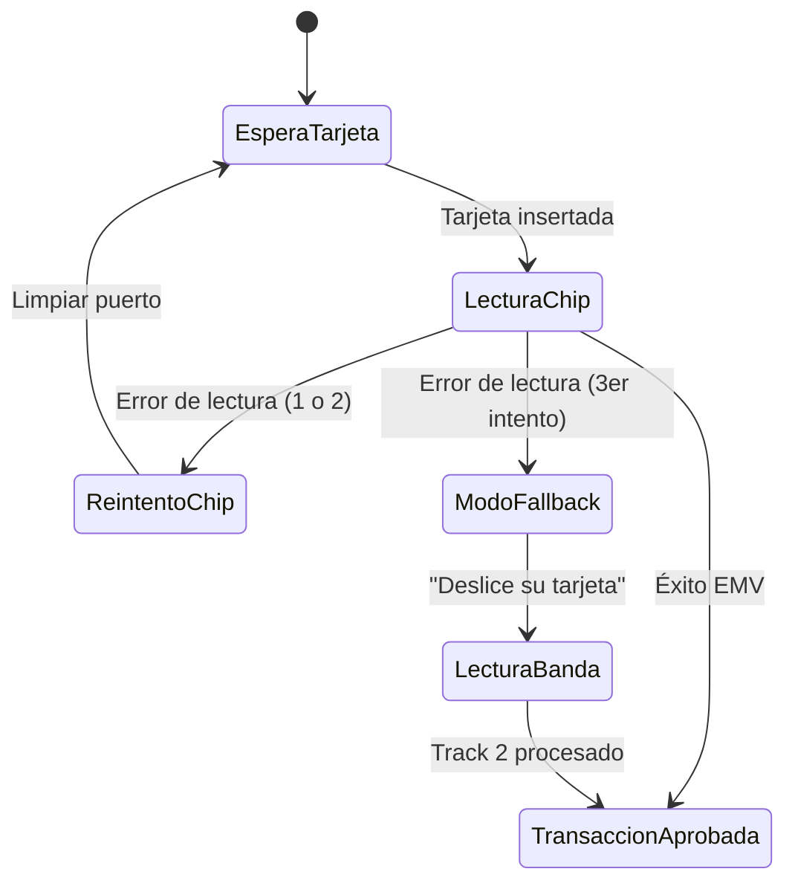

# Post 4: De Código Espagueti a Clean Architecture en Lectura de Tarjetas

**Autor:** Alejandro Barragán Jasso  
**Enfoque:** Tech Lead / Mobile & Embedded Payment Systems Engineer

---

## 📱 Copia para Publicación en LinkedIn

```text
🏗️ Refactorización extrema en sistemas transaccionales: Casos de uso, corrutinas limpias y fallback resiliente

Interactuar con hardware físico de cobro (sensores de chip, cabezales magnéticos, impresoras) en una app móvil es uno de los terrenos más propensos a memory leaks y estados inconsistentes si no se aplica una arquitectura limpia.

En este carrusel comparto los principios que aplicamos para migrar una librería transaccional hacia Kotlin moderno:
• Eliminación de fugas de corrutinas en llamadas a hardware.
• Máquina de estados determinista para contingencia por chip dañado (Fallback a banda).
• Desacoplamiento total de pantallas secundarias orientadas al cliente.

Desliza para ver el antes y después arquitectónico. 👇

#CleanArchitecture #Kotlin #Coroutines #StatePattern #AndroidDev #Refactoring
```

---

## 📊 Pregunta de Debate

> *"Al manejar fallos mecánicos o de hardware en apps móviles, ¿prefieres máquinas de estado finitas o programación reactiva pura?"*

---

## 🏛️ Diagrama de Máquina de Estados de Contingencia



---

## 💻 Código de Ejemplo
- Implementación Kotlin: [`examples/04_clean_architecture_fallback/PaymentStateMachine.kt`](../examples/04_clean_architecture_fallback/PaymentStateMachine.kt)
- Simulador ejecutable Python: [`examples/04_clean_architecture_fallback/payment_state_machine.py`](../examples/04_clean_architecture_fallback/payment_state_machine.py)
